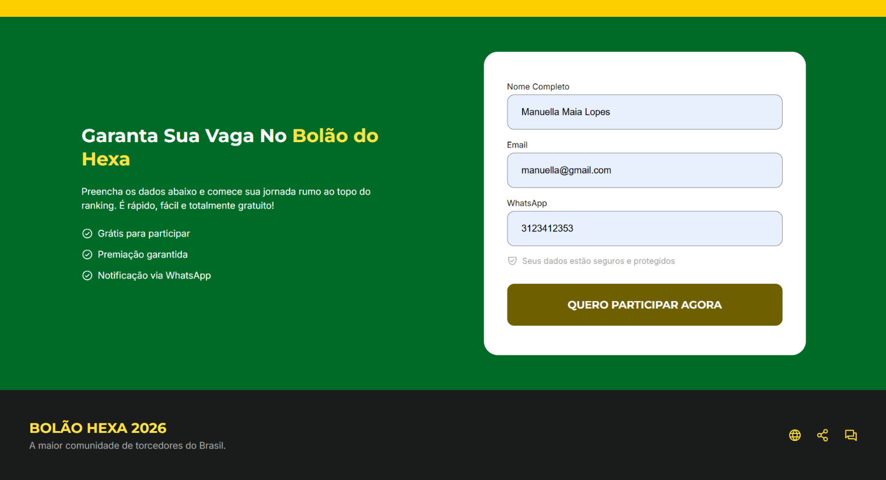
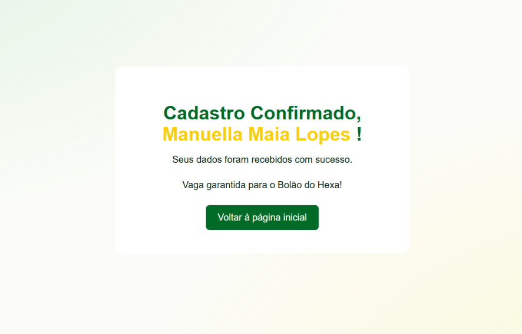

<p align="center">
  
</p>

<h1 align="center">Bolão Hexa 2026 🏆</h1>

<p align="center">
  Landing page temática para apresentar o Bolão Hexa 2026 e permitir o cadastro de participantes.
</p>

## Sobre o projeto

O **Bolão Hexa 2026** é uma página web temática da Copa do Mundo FIFA 2026. O projeto reúne uma interface de divulgação do bolão e um fluxo de cadastro desenvolvido com **HTML, CSS e PHP**.

Além da construção da interface, foi implementado o recebimento e o processamento dos dados enviados pelo formulário, a validação no servidor e uma página de confirmação personalizada.

> **Observação:** o cadastro demonstra o fluxo de recebimento e confirmação dos dados. O código disponibilizado não implementa persistência em banco de dados.

## Funcionalidades desenvolvidas

- **Apresentação do projeto:** chamada principal para participação no bolão.
- **Como participar:** seção com etapas ilustrativas para o participante.
- **Jogos em destaque:** cards com partidas da Seleção Brasileira.
- **Ranking ilustrativo:** apresentação de participantes e pontuações de exemplo.
- **Benefícios:** seção com vantagens de participação.
- **Formulário de cadastro:** campos para nome completo, e-mail e WhatsApp.
- **Validação no PHP:** verificação do nome e do e-mail enviados pelo formulário.
- **Mensagens de erro:** retorno na própria página quando nome ou e-mail não atendem às validações implementadas.
- **Confirmação de cadastro:** redirecionamento para `sucesso.php`, exibindo o nome armazenado na sessão.
- **Navegação por âncoras:** links para as principais seções da página.

## Tecnologias e recursos

- **HTML5** — estruturação semântica da página e do formulário.
- **CSS3** — estilização e organização visual das seções.
- **PHP** — processamento dos dados enviados e geração da confirmação.
- **Sessões PHP** — armazenamento temporário do nome para exibição na página de sucesso.
- **Google Fonts** — tipografia utilizada na interface.
- **Phosphor Icons e Lucide** — ícones da interface.
- **FlagCDN** — imagens de bandeiras utilizadas nos cards de jogos.

## Implementação do formulário e do PHP

O formulário em `index.php` utiliza `method="POST"` e envia os campos ao próprio arquivo por meio de `action="index.php"`. Os atributos `name` dos campos permitem acessar os valores no PHP.

### Fluxo de processamento

1. O PHP inicia a sessão com `session_start()`.
2. A variável superglobal `$_SERVER["REQUEST_METHOD"]` é consultada para verificar se a requisição utiliza o método `POST`.
3. Os valores são lidos de `$_POST` e tratados com `trim()`.
4. O nome é validado para impedir o envio vazio e exigir pelo menos três caracteres.
5. O e-mail é validado para verificar se foi informado e se possui formato válido com `filter_var()` e `FILTER_VALIDATE_EMAIL`.
6. Quando não há erros registrados, o nome é salvo em `$_SESSION["nome_usuario"]`.
7. O navegador é redirecionado para `sucesso.php`, que recupera o nome da sessão e apresenta a confirmação.

### Operadores PHP utilizados

| Operador | Exemplo no projeto | Finalidade |
| --- | --- | --- |
| Atribuição (`=`) | `$nome = "";` | Atribuir valores às variáveis. |
| Comparação estrita (`===`) | `$_SERVER["REQUEST_METHOD"] === "POST"` | Comparar valores e tipos. |
| Diferente (`!==`) | Não utilizado no trecho atual | — |
| Menor que (`<`) | `mb_strlen($nome) < 3` | Verificar se o nome tem menos de três caracteres. |
| Negação lógica (`!`) | `!filter_var(...)` | Inverter o resultado lógico de uma condição. |
| Coalescência nula (`??`) | `$_POST["nome"] ?? ""` | Usar um valor padrão quando a chave não está definida ou é nula. |

Também são aplicadas estruturas condicionais (`if`/`elseif`), a função `empty()` para verificar se há erros e a função `isset()` para identificar se uma mensagem de erro deve ser exibida.

**Importante:** o código atual não contém operações aritméticas; a aplicação dos operadores é voltada principalmente à atribuição, comparação e avaliação lógica das condições de validação.

### Validações implementadas

- **Nome:** obrigatório e com pelo menos três caracteres, verificado no servidor.
- **E-mail:** obrigatório e validado com `FILTER_VALIDATE_EMAIL`.
- **WhatsApp:** o campo é obrigatório no HTML, mas não há validação específica do número no processamento PHP atual.

Os atributos HTML, como `required`, `minlength` e `type="email"`, ajudam na validação no navegador, mas não substituem a validação no servidor.

## Evidências e demonstração

As imagens e o vídeo abaixo documentam o formulário e o resultado do envio. Os arquivos estão organizados em `docs/assets/`.

### Formulário de cadastro



### Confirmação após o envio



### 📹 Vídeo Demonstrativo

▶️ **[Clique aqui para assistir à demonstração do Bolão Hexa 2026](https://drive.google.com/drive/folders/1m_T9DY8XeCrx_B7kcVB3rbDkSza9eeJx?usp=sharing)**

O vídeo está versionado como arquivo do projeto. Caso o repositório ou a plataforma não reproduza o MP4 diretamente, baixe o arquivo pelo link acima para assistir.

## Estrutura relevante

```text
.
├── index.php
├── sucesso.php
├── resources/
│   ├── assets/
│   │   ├── imgs/
│   │   └── favicons/
│   └── style/
│       ├── style.css
│       └── styleValidacao.css
└── docs/
    └── assets/
        ├── formulario-cadastro.png
        ├── confirmacao-cadastro.png
        └── demonstracao-bolao-hexa.mp4
```

*Os nomes de arquivos de estilo e recursos acima correspondem à organização esperada no projeto; mantenha os caminhos alinhados aos arquivos existentes no repositório.*

## Como executar localmente

Como o projeto utiliza PHP, execute-o por um servidor com suporte a PHP. O Live Server, isoladamente, não processa arquivos PHP.

### Opção 1 — PHP instalado

1. Clone ou baixe o repositório.
2. Abra um terminal na pasta do projeto.
3. Inicie o servidor embutido do PHP:

   ```bash
   php -S localhost:8000
   ```

4. Acesse `http://localhost:8000/index.php` no navegador.
5. Preencha o formulário e envie os dados para testar o fluxo de validação e confirmação.

### Opção 2 — Laragon

1. Coloque a pasta do projeto no diretório de projetos utilizado pelo Laragon.
2. Inicie o servidor web pelo Laragon.
3. Acesse o projeto pelo endereço local configurado.

## Possíveis melhorias futuras

- Validar o formato do WhatsApp também no servidor.
- Aplicar escape de saída, por exemplo `htmlspecialchars()`, ao exibir o nome recebido na página de confirmação.
- Persistir os cadastros em um banco de dados, caso isso passe a fazer parte do escopo.
- Disponibilizar uma URL pública para demonstração.

## Licença

Este software está disponível sob a licença [MIT](https://rem.mit-license.org).
